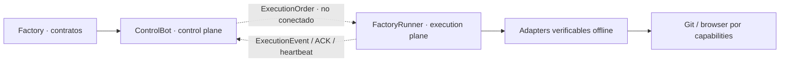

# FactoryRunner

> Execution plane programático y auditable para ejecutar órdenes gobernadas por ControlBot.

**Rol:** execution plane · **Fase:** construcción (sin go-live) · **Roadmap:** [FactoryRunner #1](https://github.com/pl0n3r/FactoryRunner/issues/1) + [Factory #168](https://github.com/pl0n3r/Factory/issues/168)

FactoryRunner implementa contratos verificables de ejecución. ControlBot gobierna el despacho y conserva el estado durable. El código usa [Node.js 24 + TypeScript](AGENTES.md), pero **no hay integración live ni despliegue acreditado**: [#431](https://github.com/pl0n3r/FactoryRunner/issues/431) autoriza solo preparación offline.

## Operational Cockpit

[](https://github.com/pl0n3r/FactoryRunner/actions/workflows/ci.yml)
[](https://github.com/pl0n3r/FactoryRunner/releases)

[GitHub Actions](https://github.com/pl0n3r/FactoryRunner/actions) · [GitHub Releases](https://github.com/pl0n3r/FactoryRunner/releases) · [Orquestador de ControlBot](https://control.condorapp.com.co/) (acceso restringido; el enlace no certifica conexión del Runner).

No se muestra un `/health` público: el [observador local](docs/local-observer.md) es una **demo sintética local**, no un servicio productivo. Estas señales se actualizan al visualizar GitHub, sin commits de refresco ni porcentajes inferidos.

## Work Queue

- **NOW:** [Issues abiertos con reserva activa](https://github.com/pl0n3r/FactoryRunner/issues?q=is%3Aissue%20is%3Aopen%20label%3A%22estado%3A%20reservado%22); verificar el UUID V3 y el PR antes de continuar.
- **NEXT:** [Issues abiertos disponibles](https://github.com/pl0n3r/FactoryRunner/issues?q=is%3Aissue%20is%3Aopen%20label%3A%22estado%3A%20disponible%22); tomar trabajo solo tras validar dependencias, claims y autorización.
- **LATER:** [Issues abiertos planificados](https://github.com/pl0n3r/FactoryRunner/issues?q=is%3Aissue%20is%3Aopen%20label%3A%22estado%3A%20planificado%22); el [observador con fuente auténtica #465](https://github.com/pl0n3r/FactoryRunner/issues/465) permanece como dirección de producto, no como trabajo ya habilitado.
- **BLOCKED:** [Issues abiertos bloqueados](https://github.com/pl0n3r/FactoryRunner/issues?q=is%3Aissue%20is%3Aopen%20label%3A%22estado%3A%20bloqueado%22); no convertir cierre histórico o ausencia de evidencia en autorización operativa.

Historial de adopción: [#20](https://github.com/pl0n3r/FactoryRunner/issues/20) · [Factory #168](https://github.com/pl0n3r/Factory/issues/168). Esta cola es navegación dinámica filtrada por estado y apertura; la fuente de verdad son los Issues en GitHub. El repositorio público es el estado canónico según D-062; PII, credenciales, cookies y secretos siguen prohibidos en el repositorio.

## Qué hace el producto

El [roadmap #1](https://github.com/pl0n3r/FactoryRunner/issues/1) documenta contratos implementados y probados para:

- [identidad, capacidades y heartbeat](src/runner.ts) con capacidad fail-closed;
- [órdenes idempotentes](src/order.ts) y [eventos](src/event.ts), con validación de referencias;
- [adapters programáticos](src/adapters/) y browser portable, sin ejecución remota habilitada;
- [cliente tipado ControlBot](src/controlbot/) y [observador sintético](docs/local-observer.md), **sin captura de sesiones ni datos reales**.

El estado durable y la prioridad pertenecen a [ControlBot](https://github.com/pl0n3r/ControlBot), no al Runner.

## Arquitectura en 60 segundos



Las flechas discontinuas describen **interfaces, no conexiones desplegadas**: [cliente ControlBot](src/controlbot/) y [puerta humana #431](https://github.com/pl0n3r/FactoryRunner/issues/431). [AutoFactory](https://github.com/pl0n3r/AutoFactory) permanece local/manual e independiente.

## Stack e infraestructura

- **Código:** [Node.js 24 LTS + TypeScript](package.json), tests Node/Python y [CI Factory@v1](.github/workflows/ci.yml).
- **Transporte:** [contratos del cliente ControlBot](src/controlbot/) para polling, heartbeat, ACK y eventos, todavía **sin endpoint real conectado**.
- **Target:** [Hostinger Shared/Web Hosting](AGENTES.md), sin asumir Docker, root o Chromium; macOS local solo como fallback condicionado.
- **Observación:** [servidor `--demo`](docs/local-observer.md), opt-in y limitado a loopback/fixtures; no representa `/health` público real.
- **Estado durable:** corresponde a ControlBot, no a una base paralela del Runner.

## Ciclo de entrega

Issue → reserva → `trabajo/issue-N` → PR → Factory CI/policy/acceptance → revisión → merge serial → release → validación exact-main.

Una ejecución o merge no demuestra por sí solo salud del runtime. Cualquier futura señal live deberá conservar identidad exacta, evidencia y semántica fail-closed.

## Calidad y seguridad

- Sin passwords, private keys, cookies, tokens de sesión ni credenciales dentro de órdenes o del repositorio.
- Alias/referencias sustituyen identidades sensibles cuando basta para el contrato.
- Permisos y capabilities se mantienen mínimos; el Runner nunca expande su propia autoridad.
- CI consume Factory v1 y ejecuta typecheck, tests Node y contratos Python.
- Los cambios de seguridad, runtime o ejecución privilegiada requieren evidencia reproducible y rollback definido.
- CAPTCHA, MFA y rate limits no se evaden.

## Roadmap y fuentes de verdad

- [FactoryRunner #1](https://github.com/pl0n3r/FactoryRunner/issues/1): roadmap del execution plane.
- [Issues](https://github.com/pl0n3r/FactoryRunner/issues) y [PRs](https://github.com/pl0n3r/FactoryRunner/pulls): trabajo y evidencia operativa.
- [PLAN-AGENTES.md](https://github.com/pl0n3r/factory/blob/main/PLAN-AGENTES.md): gobernanza y orden de despacho.
- [AGENTES.md](AGENTES.md) y [decisiones.yml](decisiones.yml): límites y decisiones.
- [datos.yml](datos.yml) y [docs/](docs/): privacidad y documentación profunda.
- [#431](https://github.com/pl0n3r/FactoryRunner/issues/431) y [#465](https://github.com/pl0n3r/FactoryRunner/issues/465): autorización live y fuente real pendientes.

La evidencia exacta en Issues, PRs y pruebas manda sobre cualquier texto histórico de esta portada.

## Desarrollo local

Requisitos: Node.js 24 LTS, npm y Python 3 para los contratos auxiliares.

```bash
npm ci --ignore-scripts --no-audit --no-fund
npm run typecheck
npm test
npm run build
python3 -m unittest discover -s tests -p 'test_*.py'
```

No se requieren credenciales reales para ejecutar la suite de contratos.

## Mapa de la fábrica

- **Factory** — governance/kit y contratos comunes.
- **ControlBot** — control plane, priorización, elegibilidad y estado durable.
- **FactoryRunner** — execution plane; ejecuta órdenes ya gobernadas y reporta evidencia.
- **Condor / GrindFlow / BRVTAL** — productos construidos por la fábrica.
- **AutoFactory** — herramienta local/manual del dueño.

**AutoFactory no se migra ni se modifica desde FactoryRunner.** Los dos productos pueden coexistir y evolucionar de forma independiente.
